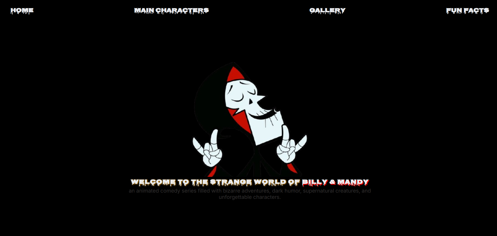

# The Grim Adventures of Billy & Mandy
- A fan made website. inspired by The Grim Adventures of Billy and Mandy. explore the characters and discover fun facts and memorable moments.

## Live Demo

[Visit Website](https://udayprakash999.github.io/Billy-Mandy/)

## Project ScreenShot

## About The Project

I created this project as a fan made tribute to the frim adventures of billy and mandy . one of the most memorable animated show. the goal was to build an engaging website where fans can explore the show's characters and know about their fav show . this project also helped me in my frontend journey.

# Features
- homepage with introduction to the show
- character section
- image gallery
- fun facts about the series
- Responsive layout for Desktop, tablet and mobile
- Dark theme spooky style
- google fonts 

## Tech Stack

- HTML5
- CSS3
- JavaScript
- Google Fonts
- Media queries for responsive design
- Git And Github

## How I Built It

- planned the layoit
- created the structure
- designed the interface
- added interactivity
- made it responsive
- deployed the project

## what I Learned

- building a complete web using html CSS and JS.
- creating a consistent visual theme.
- hosting a frontend project using Github pages

## 👨‍💻 Author

**Uday Prakash**

- GitHub: [@udayprakash999](https://github.com/udayprakash999)
